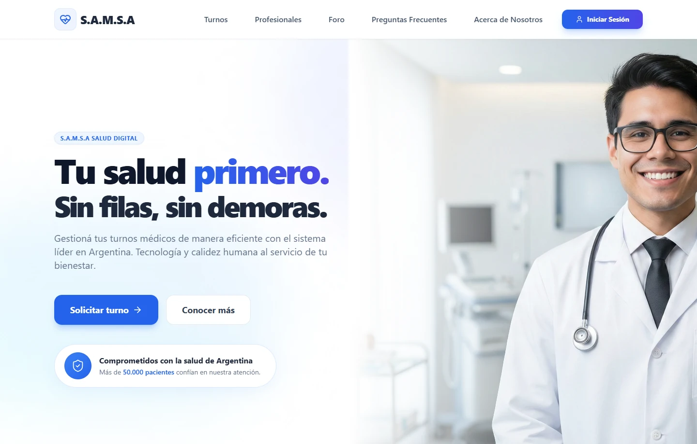
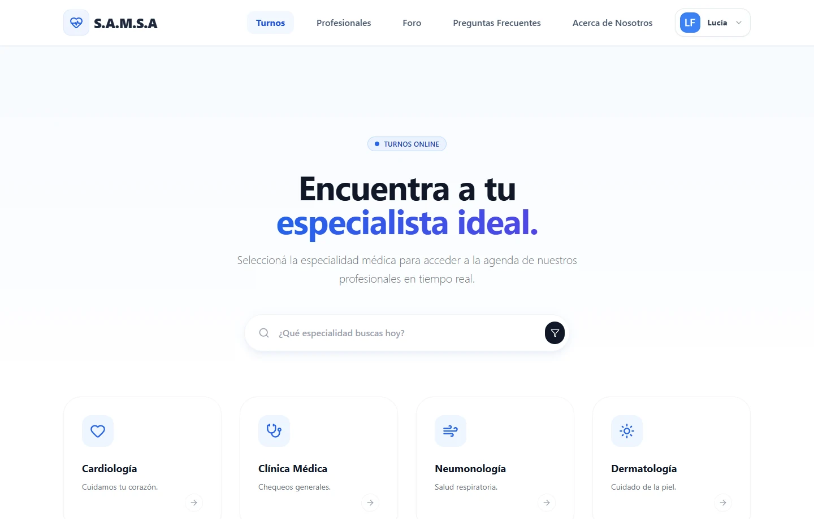
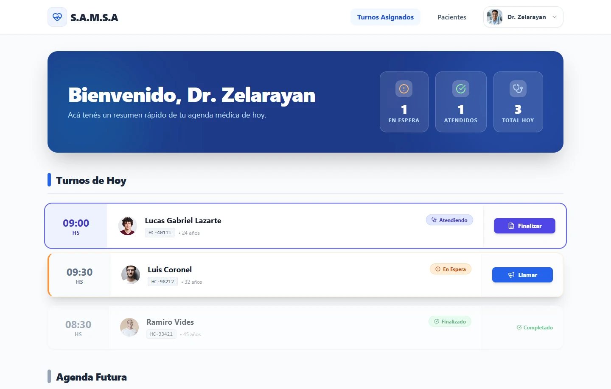
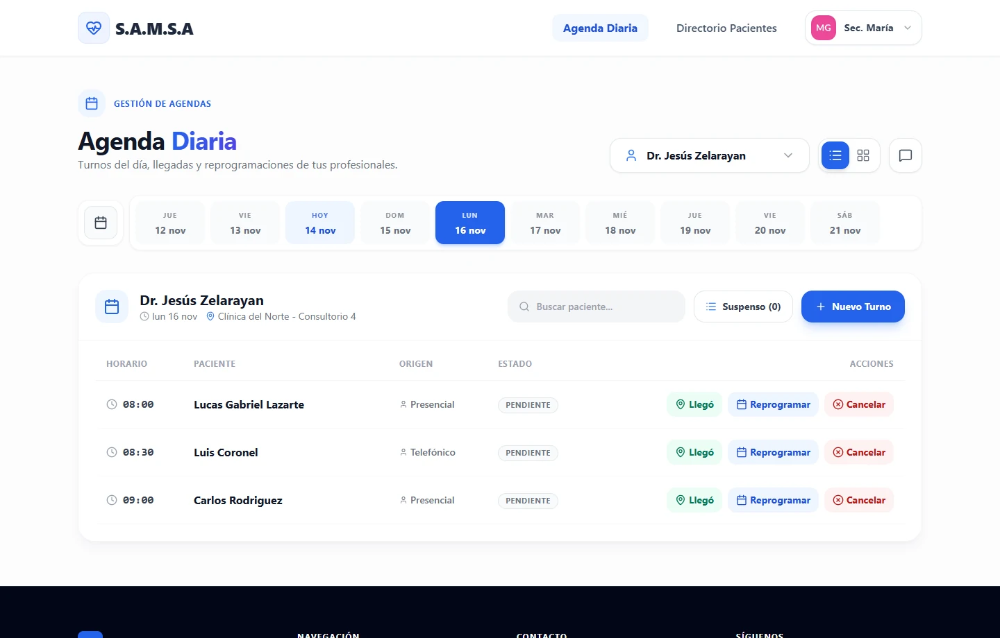
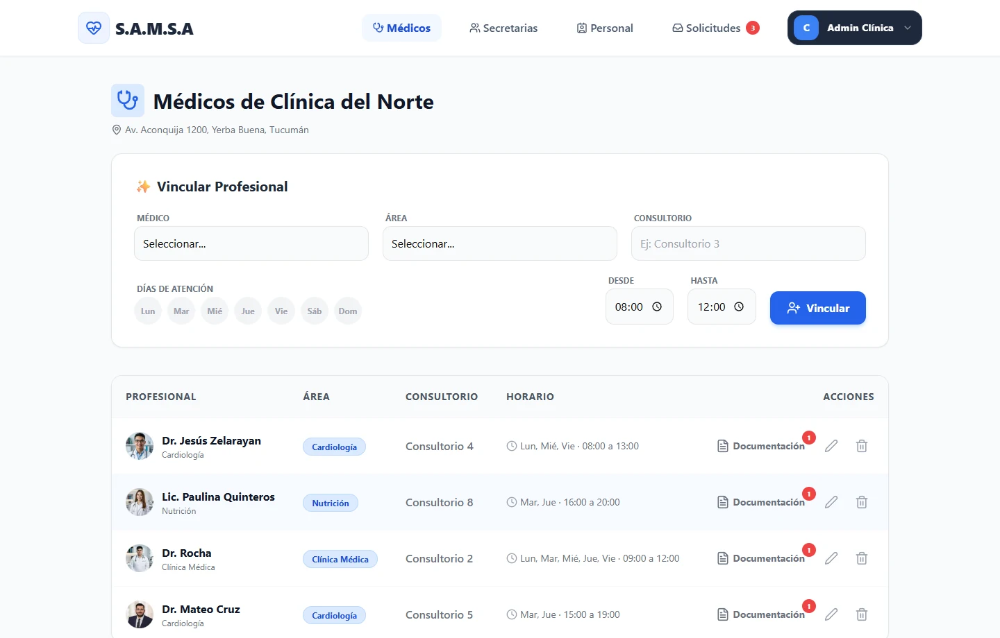
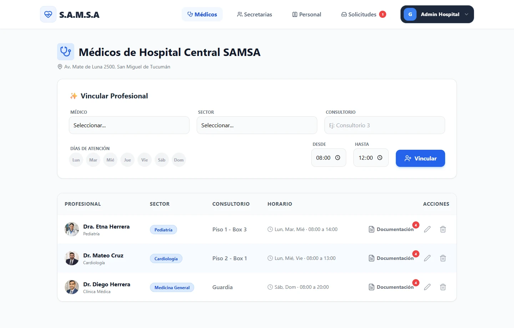
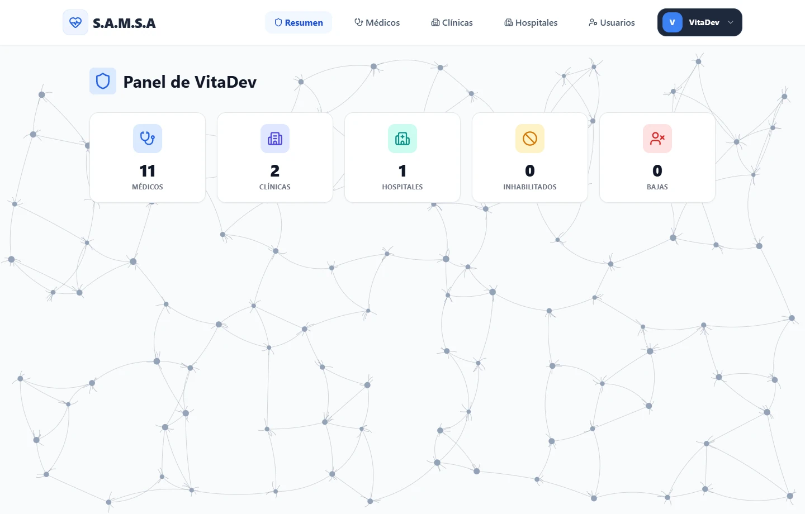
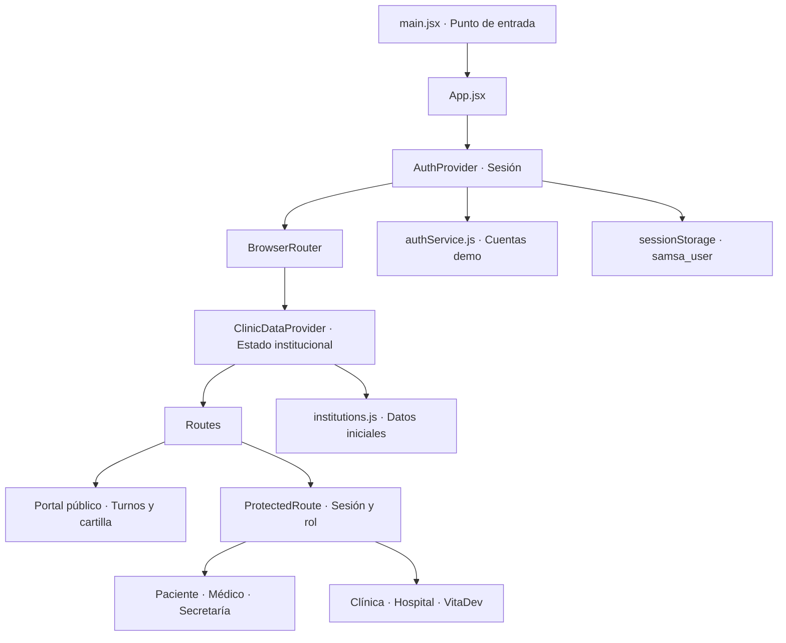
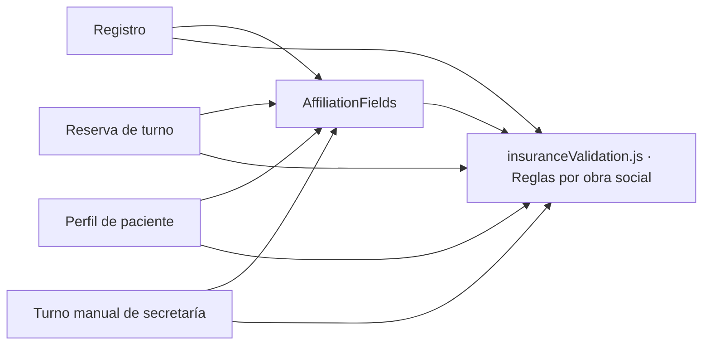

<div align="center">
  
  <h1>S.A.M.S.A.</h1>
  <p><strong>Sistema de Atención Médica y Salud Argentina</strong></p>
  <p>Turnos, agendas profesionales y gestión institucional en una plataforma de VitaDev.</p>
  <p>
    <a href="#galería-de-módulos">Galería de módulos</a> ·
    <a href="#arquitectura">Arquitectura</a> ·
    <a href="#ejecución-local">Ejecución local</a> ·
    <a href="docs/INDEX.md">Documentación</a>
  </p>
</div>

[](docs/assets/readme/portal-publico.webp)

[Portal en móvil](docs/assets/readme/portal-movil.webp) · [Portal en tableta](docs/assets/readme/portal-tablet.webp)

## Galería de módulos

Las capturas se realizaron en el entorno local con cuentas de demostración. Cada imagen se puede abrir a tamaño completo.

| Módulo | Vista principal | Operaciones |
| --- | --- | --- |
| [Pacientes](#pacientes) | `/turns` | Buscar especialistas, solicitar turnos y consultar estudios y reservas. |
| [Médicos](#médicos) | `/doctor/turns` | Gestionar la agenda, consultar pacientes y acceder a protocolos. |
| [Secretaría](#secretaría) | `/secretary/dashboard` | Coordinar agendas, registrar turnos manuales y consultar pacientes. |
| [Administración de clínica](#administración-de-clínica) | `/clinic/doctors` | Administrar el equipo de la clínica y sus solicitudes. |
| [Administración de hospital](#administración-de-hospital) | `/hospital/doctors` | Gestionar médicos, secretarías, solicitudes y datos del hospital. |
| [Administración VitaDev](#administración-vitadev) | `/vitadev/dashboard` | Visualizar la red institucional y gestionar instituciones, profesionales y usuarios. |

### Pacientes

La pantalla de turnos permite buscar atención por profesional y acceder a la reserva. Las áreas privadas reúnen los turnos, estudios y reseñas del paciente.

[](docs/assets/readme/paciente-turnos.webp)

[Mis turnos](docs/assets/readme/paciente-mis-turnos.webp) · [Estudios](docs/assets/readme/paciente-estudios.webp)

### Médicos

El panel profesional reúne la agenda, el directorio de pacientes y los protocolos institucionales.

[](docs/assets/readme/medico-agenda.webp)

[Protocolos](docs/assets/readme/medico-protocolos.webp)

### Secretaría

La agenda de recepción permite revisar las citas por médico y registrar turnos manuales con los campos de afiliación a la obra social.

[](docs/assets/readme/secretaria-agenda.webp)

[Formulario de turno manual](docs/assets/readme/secretaria-turno-manual.webp) · [Directorio de pacientes](docs/assets/readme/secretaria-pacientes.webp)

### Administración de clínica

La administración de la clínica dispone de vistas para médicos, secretarías, solicitudes, foro y datos de su institución.

[](docs/assets/readme/clinica-medicos.webp)

[Solicitudes de la clínica](docs/assets/readme/clinica-solicitudes.webp)

### Administración de hospital

El hospital utiliza las mismas pantallas institucionales con sus propios datos y rutas.

[](docs/assets/readme/hospital-medicos.webp)

### Administración VitaDev

El panel muestra la red de instituciones y profesionales. El directorio concentra las operaciones de gestión de usuarios.

[](docs/assets/readme/vitadev-panel.webp)

[Directorio de usuarios](docs/assets/readme/vitadev-usuarios.webp)

## Arquitectura

La aplicación utiliza **React 19**, **Vite 7**, **React Router 7** y **Tailwind CSS 3.4**. La sesión de demostración se guarda en `sessionStorage`. Las rutas protegidas verifican el rol en el cliente y los proveedores comparten la sesión y los datos mock entre las pantallas.

### Enrutamiento y estado compartido



### Validación de datos de afiliación



| Ruta en el repositorio | Responsabilidad |
| --- | --- |
| [`src/App.jsx`](src/App.jsx) y [`src/constants/roles.js`](src/constants/roles.js) | Mapa de rutas, permisos y destinos iniciales por rol. |
| [`src/pages/`](src/pages/) y [`src/components/`](src/components/) | Pantallas por módulo y componentes reutilizables. |
| [`src/context/`](src/context/) y [`src/services/`](src/services/) | Sesión y operaciones de autenticación de demostración. |
| [`src/data/`](src/data/) y [`src/utils/`](src/utils/) | Datos iniciales, reglas de validación y utilidades. |
| [`api/submit-form.js`](api/submit-form.js) | Envío del formulario de adhesión profesional mediante Resend cuando el entorno está configurado. |

## Ejecución local

La integración continua utiliza Node.js 20. Para Vite 7, use Node.js 20.19 o posterior dentro de esa versión, o Node.js 22.12 o posterior.

```bash
git clone https://github.com/vitadevorg/samsa.git
cd samsa
git checkout development
npm ci
npm run dev
```

Abra [el entorno local](http://localhost:5173/). Para recorrer las vistas protegidas, inicie sesión en `/login` con una de las cuentas de demostración definidas en [`authService.js`](src/services/authService.js).

```bash
npm run lint
npm run build
npm run preview
```

El entorno Vite permite navegar por el frontend y sus datos de demostración. El envío de la solicitud de adhesión requiere ejecutar el endpoint `/api/submit-form` en un entorno compatible y configurar `RESEND_API_KEY` en el servidor.

## Documentación y contribuciones

- [Índice de documentación](docs/INDEX.md)
- [Arquitectura, roles y mapa de rutas](docs/arquitectura-y-roles.md)
- [Sistema de diseño y criterios responsive](docs/design-system.md)
- [Flujo de trabajo con Git, Pull Requests y Trello](docs/flujo-codigo-trello.md)
- [Historial de tareas y entregas](docs/tareas/INDEX.md)
